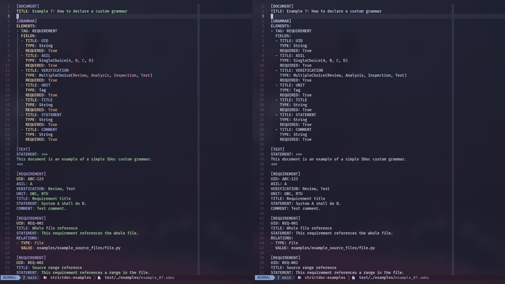

# StrictDoc Tree‑Sitter Parser for Neovim

This repository provides a Tree‑Sitter grammar for [StrictDoc](https://strictdoc.readthedocs.io/) and instructions to integrate it into Neovim using [nvim-treesitter](https://github.com/nvim-treesitter/nvim-treesitter).

## Prerequisites

- Neovim >= 0.11 with [nvim-treesitter](https://github.com/nvim-treesitter/nvim-treesitter/tree/main) (**main branch**) installed
- A C compiler (`gcc` or `clang`) to build the parser
- Git
- [tree-sitter-rst](https://github.com/stsewd/tree-sitter-rst) for injections.

## Installation

### Using LazyVim

1. Place the following file in `~/.config/nvim/lua/plugins/nvim-treesitter.lua`:

   ```lua
    -- ref: https://github.com/nvim-treesitter/nvim-treesitter/tree/main?tab=readme-ov-file

    return {
    "nvim-treesitter/nvim-treesitter",

    -- The `opts` function allows you to safely modify the plugin's options
    opts = function(_, opts)
        -- Add `strictdoc` to the `ensure_installed` list
        if type(opts.ensure_installed) == "table" then
        vim.list_extend(opts.ensure_installed, { "strictdoc" })
        end
    end,

    init = function()
        -- Register the filetypes
        -- This tells Neovim to use the 'strictdoc' filetype for .sdoc and .sgra files.
        vim.filetype.add({
        extension = {
            sdoc = "strictdoc",
            sgra = "strictdoc",
        },
        })

        -- Define the custom parser
        vim.api.nvim_create_autocmd("User", {
        pattern = "TSUpdate",
        callback = function()
            require("nvim-treesitter.parsers").strictdoc = {
            install_info = {
                url = "https://github.com/manueldiagostino/tree-sitter-strictdoc",
                files = { "src/parser.c" },
                queries = "queries",
            },
            filetype = "strictdoc", -- Associate this parser with the 'strictdoc' filetype
            }
        end,
        })
    end,
    }
   ```

2. To verify the installation, restart Neovim and run:

   ```vim
   :checkhealth nvim-treesitter
   ```

## Usage

Open any `.sdoc` or `.sgra` file in Neovim. The filetype should be detected as
`strictdoc`, the parser will load automatically, and Tree‑Sitter will provide
syntax highlighting and injections.

If highlighting isn't applied, verify:

```vim
:echo &filetype    " should return 'strictdoc'
:TSBufEnable highlight
```

## Example



## Integrations

- [Helix](https://helix-editor.com/) - thanks to [@puzzlewolf](https://github.com/puzzlewolf)

## References

- StrictDoc [official website](https://strictdoc.readthedocs.io/en/stable/)
- StrictDoc [grammar](https://github.com/strictdoc-project/strictdoc/tree/main/strictdoc/backend/sdoc/grammar)
- [nvim-treesitter](https://github.com/nvim-treesitter/nvim-treesitter)
- [Adding custom parsers](https://github.com/nvim-treesitter/nvim-treesitter/wiki/Adding-parsers) to nvim-treesitter

## Contributing

Contributions are welcome! Please open issues or pull requests against this
repository. Make sure test your changes locally before submitting.

## License

This project is licensed under the MIT License. See [LICENSE](./LICENSE) for details.
